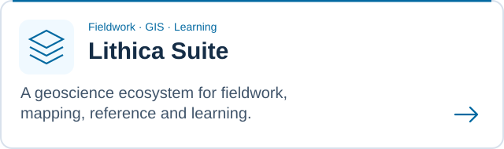
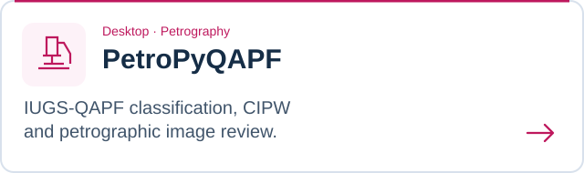
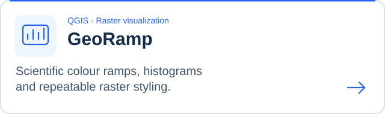
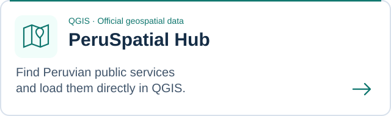
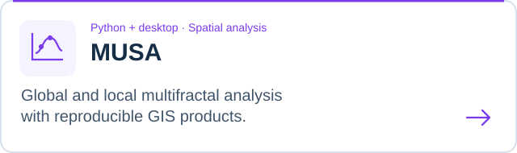
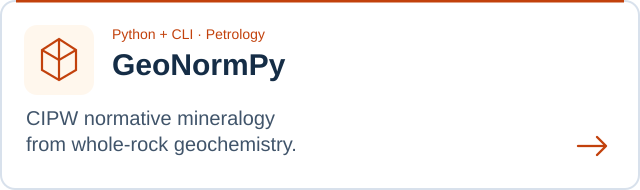
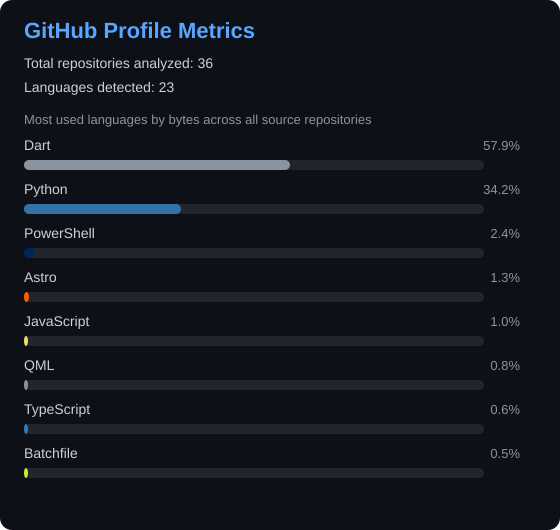

# Jordan Zavaleta

**Geological engineering student at UNI · applied geophysics · GIS · scientific software**

Funky! Powered by geoscience and [⑨](https://www.youtube.com/watch?v=CNAxjkyocsA) energy.

I build open and reproducible tools that connect geological interpretation,
potential-field geophysics, remote sensing, terrain analysis and field-ready GIS.

I study Geological Engineering at Universidad Nacional de Ingeniería in Lima,
Peru. My interests include mineral exploration and geological hazards.
Alongside software development, I contribute to research, technical training
and student outreach.

## Making geoscience more accessible

I develop tools for fieldwork, mapping, petrography and reproducible analysis,
with documentation that helps students, researchers and practitioners use them.

### Featured projects

Explore Lithica's geoscience ecosystem, PetroPyQAPF's desktop workflow and my
open-source tools. Each project page explains its access and licensing terms.

<table>
  <tr>
    <td width="50%"><a href="https://github.com/jordan-zav/Lithica-Suite"><picture><source media="(prefers-color-scheme: dark)" srcset="assets/profile/lithica-dark.svg"><source media="(prefers-color-scheme: light)" srcset="assets/profile/lithica.svg"></picture></a></td>
    <td width="50%"><a href="https://gisgeo.dev/es/portfolio/petropyqapf/"><picture><source media="(prefers-color-scheme: dark)" srcset="assets/profile/petropyqapf-dark.svg"><source media="(prefers-color-scheme: light)" srcset="assets/profile/petropyqapf.svg"></picture></a></td>
  </tr>
  <tr>
    <td width="50%"><a href="https://github.com/jordan-zav/GeoRamp"><picture><source media="(prefers-color-scheme: dark)" srcset="assets/profile/georamp-dark.svg"><source media="(prefers-color-scheme: light)" srcset="assets/profile/georamp.svg"></picture></a></td>
    <td width="50%"><a href="https://github.com/jordan-zav/Peruspatial-Hub"><picture><source media="(prefers-color-scheme: dark)" srcset="assets/profile/peruspatial-dark.svg"><source media="(prefers-color-scheme: light)" srcset="assets/profile/peruspatial.svg"></picture></a></td>
  </tr>
  <tr>
    <td width="50%"><a href="https://github.com/jordan-zav/MUSA"><picture><source media="(prefers-color-scheme: dark)" srcset="assets/profile/musa-dark.svg"><source media="(prefers-color-scheme: light)" srcset="assets/profile/musa.svg"></picture></a></td>
    <td width="50%"><a href="https://github.com/jordan-zav/GeoNormPy"><picture><source media="(prefers-color-scheme: dark)" srcset="assets/profile/geonormpy-dark.svg"><source media="(prefers-color-scheme: light)" srcset="assets/profile/geonormpy.svg"></picture></a></td>
  </tr>
</table>

### More tools

| Task | Project | What it produces |
| --- | --- | --- |
| Visualize terrain | [QGIS-RRIM](https://github.com/jordan-zav/QGIS-RRIM) | Slope, differential openness and RRIM RGB rasters |
| Extract raster signatures | [MIRAGE](https://github.com/jordan-zav/MIRAGE) | Connected curves and features for GIS review |
| Georeference a map | [GeoRefMaps](https://github.com/jordan-zav/GeoRefMaps) | Reviewed control points and a georeferenced GeoTIFF |
| Convert coordinate tables | [PyTAB2GIS](https://github.com/jordan-zav/PyTAB2GIS) | Explicitly referenced GIS polygon deliverables |
| Read field backups in QGIS | [Lithica Cloud Sync](https://github.com/jordan-zav/Lithica-Cloud-Sync) | Layers from Explorer and Mapper projects backed up to Google Drive |

Each repository documents installation, examples, supported workflows and
methodological scope. More project pages, manuals and research material are
available at [gisgeo.dev](https://gisgeo.dev).

## What I work on

| Domain | Focus |
| --- | --- |
| Applied geophysics | Magnetic and gravity processing, spectral filters, corrections and inversion workflows |
| GIS | QGIS plugins, CRS-aware analysis, open geospatial services and reproducible delivery |
| Geomorphometry | DEM derivatives, RRIM, terrain visualization and multiscale analysis |
| Petrology | CIPW normative mineralogy and petrographically informed machine learning |
| Remote sensing | ASTER/Landsat/DEM preparation, provenance and mineral-mapping inputs |
| Scientific software | Transparent assumptions, testable algorithms and auditable outputs |

## Research, training and community

- Undergraduate research at UNI on the impact of mine tailings on groundwater
  resources.
- Applied work combining geophysical, LiDAR and optical data for archaeological
  research, with technical documentation and team training.
- Seequent Student Associate for Leapfrog Geo and Oasis montaj, supporting
  geological modeling and geophysical training at UNI.
- Member of the SEG Sustainability Committee for 2026–2027, with an interest in
  accessible geoscience data and education across Latin America.
- Technical presentations on multifractal structural analysis, igneous rock
  classification and modular geoscience software; student event organization
  and open educational resources.

## Working principles

- Preserve the original data and distinguish source evidence from derived products.
- Make CRS, datum, units, scale and NoData assumptions explicit.
- Separate successful software execution from scientific or geological validation.
- Prefer open formats and reproducible manifests for GIS deliverables.
- Ship tests, documentation and limitations alongside algorithms.
- Attribute datasets, scientific methods and third-party software clearly.

## Main tools

  
  
  
  
  

Python · QGIS/PyQGIS · GDAL/Rasterio/GeoPandas · NumPy/SciPy · SimPEG ·
Google Earth Engine · Astro/TypeScript · GitHub Actions

## Repository activity

The metrics graphic is generated automatically from language bytes in public,
non-fork repositories. It excludes private repositories and project deliverables.
These statistics describe code distribution, not proficiency or scientific
quality.

## Contact

- Website: [gisgeo.dev](https://gisgeo.dev)
- Email: [jordanzav@gisgeo.dev](mailto:jordanzav@gisgeo.dev)
- LinkedIn: [Jordan Zavaleta](https://www.linkedin.com/in/jordan-zav/)

Unless a repository states otherwise, my original open-source projects are
distributed under GNU GPLv3 terms. Dataset, publication and dependency licences
remain independent from the software licence.
